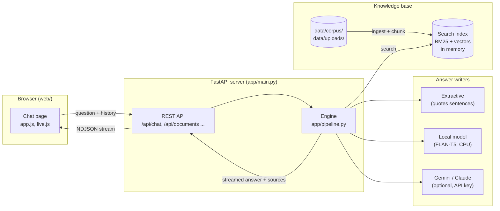
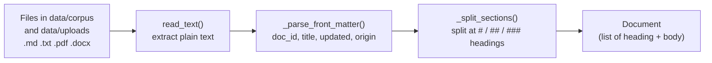
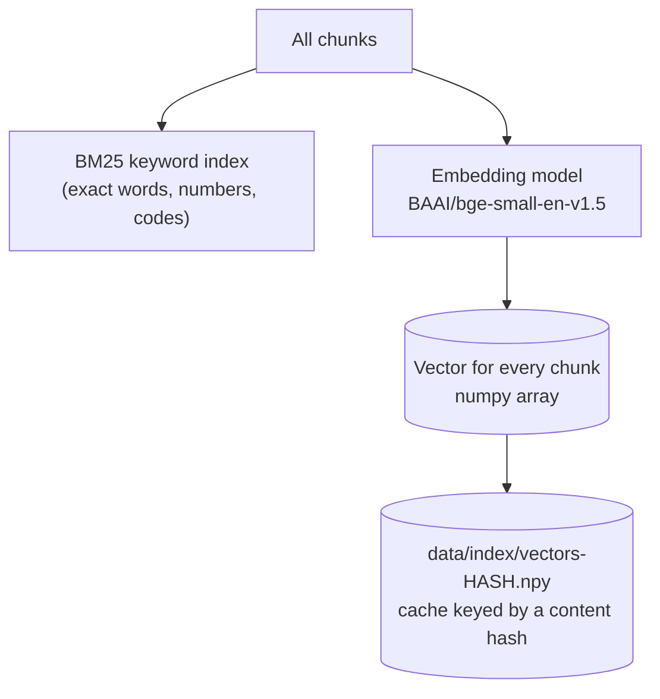
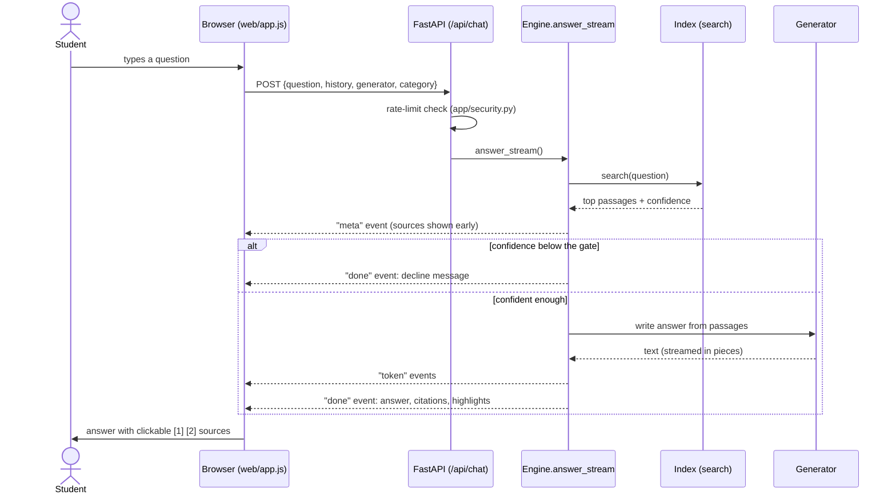
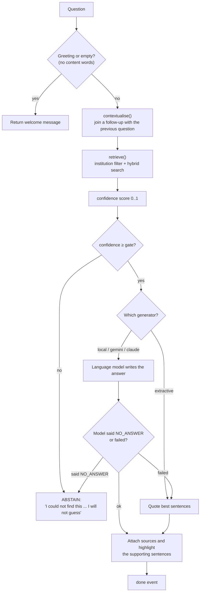
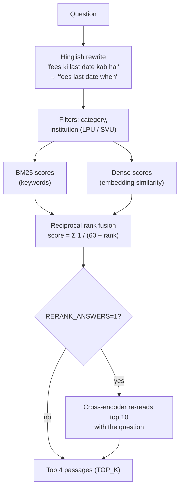
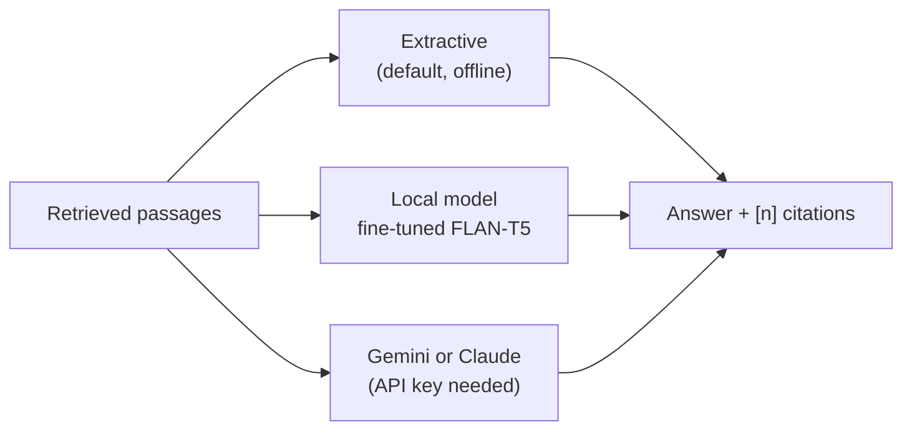
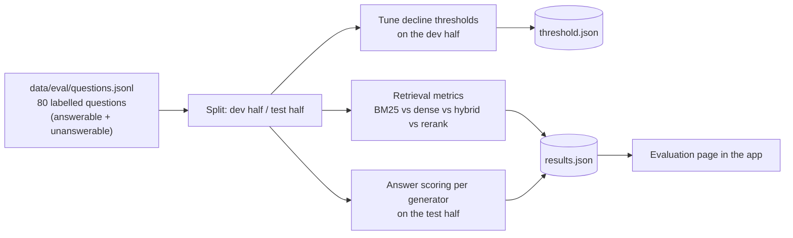
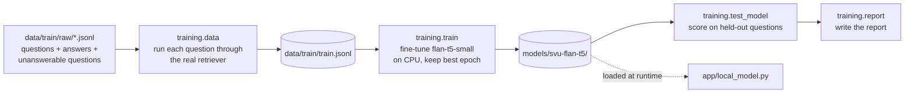

# How the Application Is Implemented, Step by Step

This guide walks through how the AI Student Assistance Chatbot ("Uni Help") was built, in
the order you would build it yourself. Each step names the file that holds the code, so you
can read the explanation and then the code. The diagrams are written in
[Mermaid](https://mermaid.js.org/), which GitHub and VS Code render automatically.

**What the application does.** A student asks a question. The app searches the university's
documents, finds the best passages, writes an answer from them, and shows the source passage
for every claim. If the documents do not cover the question, it declines instead of guessing.
This pattern is called **RAG** (retrieval-augmented generation).

---

## 1. The big picture



There are two phases:

| Phase | When it runs | What it does |
|---|---|---|
| **Indexing** (steps 3 to 5) | At server start, and after every upload or delete | Reads documents, cuts them into passages, builds the search index |
| **Answering** (steps 6 to 10) | On every question | Retrieves passages, checks confidence, writes the answer, cites sources |

---

## 2. Project setup

| Item | Detail |
|---|---|
| Language and server | Python, FastAPI, served with `uvicorn` |
| Libraries | `requirements.txt` (search and server), `requirements-model.txt` (training the local model) |
| Settings | `app/config.py`. Every setting can be overridden by an environment variable or a `.env` file |
| Start | `run.bat`, or `python -m uvicorn app.main:app --port 8000` |
| Frontend | Plain HTML, CSS and JavaScript in `web/`, with no build step |

The corpus is split into five categories: `syllabus`, `regulations`, `notices`, `faqs` and
`policies`. The folder a file sits in decides its category.

---

## 3. Step 1 of indexing: Ingest the documents

**File:** `app/ingest.py`



1. `load_all_documents()` walks both folders and keeps files with an allowed extension.
2. `read_text()` reads Markdown and text directly, and uses a PDF or DOCX reader for those formats.
3. `_parse_front_matter()` reads the small `--- ... ---` label at the top of a file (document id,
   title, category, updated date, origin).
4. `_split_sections()` cuts the body at headings, so each section is about one topic.
5. A file that cannot be read is skipped with a message, so one bad upload never breaks the app.

Each document carries an **origin**: `sample` (fictional university), `official` (from real public
pages, such as LPU) or `upload`. This is used later to avoid mixing institutions.

---

## 4. Step 2 of indexing: Chunk the documents

**File:** `app/ingest.py`, function `chunk_document()`

The retriever ranks passages, not whole files. The rule is simple:

- One section = one chunk.
- A section longer than 220 words is split into overlapping 160-word windows (40 words of overlap),
  so a sentence on a boundary stays whole in one window.
- Each chunk gets an id such as `REG-01#3` (document id + running number).

Each chunk's searchable text is `title. section. text`, so a short chunk keeps its context.

---

## 5. Step 3 of indexing: Build the search index

**File:** `app/retrieval.py`, class `Index`

Two indexes are built over the same chunks:



- **BM25** matches the student's words to the document's words. It is strong for codes like
  "CSE-204", and blind to synonyms.
- **Embeddings** turn text into vectors that capture meaning, so "recheck my paper cost" can match
  "re-evaluation fee".
- Vectors are cached on disk under a hash of the passages. If the documents have not changed, the
  saved file is loaded instead of recomputing.
- `Engine.rebuild()` (in `app/pipeline.py`) repeats all of steps 1 to 3 under a lock after every
  upload or delete, so answers always reflect the current documents.

---

## 6. Answering: the request journey

**Files:** `web/app.js`, `app/main.py`, `app/pipeline.py`



`/api/chat` returns a stream of JSON lines (NDJSON). There are four event types:

| Event | Meaning |
|---|---|
| `meta` | Confidence and the retrieved sources, sent first |
| `token` | A piece of the answer, so text appears as it is written |
| `reset` | Throw away a half-written answer (the model failed, so the app falls back) |
| `done` | The final answer, sources, highlights, generator used, latency |

---

## 7. The pipeline in detail

**File:** `app/pipeline.py`, method `Engine.answer_stream()`



The steps, in code order:

1. **Greeting check.** If the question has no content words ("hi", "thanks"), reply with a welcome.
2. **Contextualise.** A short or pronoun-led follow-up ("and for the hostel?") is searched together
   with the previous question, because it retrieves nothing useful alone.
3. **Retrieve** (step 8 below).
4. **Confidence gate** (step 9 below).
5. **Generate** (step 10 below).
6. **Cite.** `_sources()` numbers the passages and marks which sentences the answer came from, so
   the page can highlight them.

---

## 8. Retrieval: finding the right passages

**File:** `app/retrieval.py`, method `Index.search()`



- **Hinglish.** `app/hinglish.py` rewrites Hindi-English questions into rough English before search.
- **Institution filter.** If a question names exactly one institution ("attendance at LPU"), only
  that institution's documents are searched, so an answer is never mixed from two universities.
- **Fusion.** BM25 and dense rankings are merged by rank, not by raw score, so the two scales never
  have to be matched. A passage that either retriever ranks high rises to the top.
- **Reranker (optional).** A cross-encoder reads each candidate together with the question. It
  ranks better but is slower, so it is off by default.

---

## 9. The confidence gate (declining instead of guessing)

**File:** `app/retrieval.py`, method `Index.confidence()`

Confidence is the average of two signals:

| Signal | Meaning |
|---|---|
| **Coverage** | The IDF-weighted share of the question's content words found in the retrieved passages |
| **Similarity** | The best cosine similarity, rescaled from the 0.45 to 0.85 band into 0 to 1 |

If confidence is below the gate, the app answers with the decline message. There are two gates:

- **Strict** (`threshold`, about 0.45 to 0.50) when quoting the documents.
- **Loose** (`loose_threshold`, about 0.34 to 0.35) when a language model writes the answer, since the
  model can decline on its own.

Both values are **chosen from data**, not guessed. `python -m app.evaluate` tunes them on the
development half of the labelled questions and saves them to `data/eval/threshold.json`, which the
Engine loads at start.

---

## 10. Generation: writing the answer

**Files:** `app/generate.py`, `app/local_model.py`

The user picks the answer writer under "Answer by". All three produce text with `[n]` citations.



**Extractive (default).** `extractive_answer()` writes nothing new. It scores every sentence of the
retrieved passages against the question and quotes the best one, plus up to two close runners-up
from the same institution. Every word comes from the documents, so it cannot make up a fact. For
FAQ blocks, the score of the question line is passed to the answer lines that follow it.

**Local model.** `local_stream()` feeds the question and the top 3 passages to a small FLAN-T5 model
running on the CPU. Two safety checks follow:

1. If the model says `NO_ANSWER`, the app declines.
2. `unsupported_numbers()` rejects any answer containing a figure (fee, date) that is not in the
   passages. This is a guard against hallucination.

**Gemini / Claude.** `gemini_stream()` and `claude_stream()` send the passages in a prompt that
tells the model to answer only from them and to cite. These need an API key.

**Fallbacks.** If the chosen model is unavailable or fails, the app falls back to the extractive
answer and tells the student why in a note. If the model forgot to cite, `support_highlights()`
works out which passages back the answer.

---

## 11. The API and security layer

**Files:** `app/main.py`, `app/security.py`

| Endpoint | Purpose |
|---|---|
| `POST /api/chat` | Answer a question (streamed) |
| `GET /api/documents`, `GET /api/documents/{id}` | List documents and read one |
| `POST /api/documents` | Upload a document, then rebuild the index |
| `DELETE /api/documents/{id}` | Remove an upload, then rebuild the index |
| `GET /api/eval/results`, `POST /api/eval/run` | Show or re-run the evaluation |
| `POST /api/feedback` | Save a thumbs up or down |
| `GET /api/health` | Status of the index, models and generators |

Protections:

- Pydantic models validate every request body.
- `RateLimiter` limits chat, feedback and write actions per client per minute.
- Uploads are limited to 10 MB and to `.md`, `.txt`, `.pdf` and `.docx`, and file names are sanitised.
- A middleware adds security headers to every response and marks API replies `no-store`.

---

## 12. The frontend

**Files:** `web/index.html`, `web/app.js`, `web/live.js`, `web/styles.css`

- The page reads the NDJSON stream line by line, shows sources as soon as `meta` arrives, and appends
  `token` text as it comes in.
- Each `[n]` in the answer opens the matching source passage, with the supporting sentences
  highlighted. This is what lets a student check an answer against the original document.
- Other pages: a Library page (upload and delete documents), an Evaluation page, and history.

---

## 13. Evaluation: proving it works

**File:** `app/evaluate.py`, data in `data/eval/`



Run `python -m app.evaluate`. The thresholds are fitted on the development half and the answers
are scored on the held-out half, so the reported numbers are not tuned to the questions they are
measured on. The `experiments/` folder keeps the comparisons behind the sentence-selection and
decline-gate choices.

---

## 14. Training the local model (optional)

**Files:** `training/data.py`, `training/train.py`, `training/test_model.py`, `training/report.py`



Training examples come in four kinds, so the model learns when to refuse:

| Kind | Situation | Target |
|---|---|---|
| `answer` | Passages contain the answer | Answer with a `[n]` citation |
| `shuffled` | Same, passages in random order | The citation follows the passage, not its rank |
| `removed` | The answering passage is taken out | `NO_ANSWER` |
| `outside` | A question the documents do not cover | `NO_ANSWER` |

The labelled evaluation questions are never used for training, and any near-duplicate is dropped.
The model folder (about 300 MB) is not committed to git.

---

## 15. Build order summary

| # | Step | Main file |
|---|---|---|
| 1 | Set up the project, settings and folders | `app/config.py` |
| 2 | Write or collect the corpus in five categories | `data/corpus/` |
| 3 | Read files and split them into sections | `app/ingest.py` |
| 4 | Cut sections into chunks | `app/ingest.py` |
| 5 | Build BM25 and embedding indexes | `app/retrieval.py` |
| 6 | Add hybrid fusion, optional reranking, Hinglish rewrite | `app/retrieval.py`, `app/hinglish.py` |
| 7 | Add the confidence score and the decline gate | `app/retrieval.py`, `app/pipeline.py` |
| 8 | Add the extractive answer writer | `app/generate.py` |
| 9 | Add the language-model writers and fallbacks | `app/generate.py`, `app/local_model.py` |
| 10 | Tie it together in the Engine pipeline | `app/pipeline.py` |
| 11 | Expose it through the FastAPI API with security | `app/main.py`, `app/security.py` |
| 12 | Build the web interface | `web/` |
| 13 | Evaluate and tune the thresholds | `app/evaluate.py`, `data/eval/` |
| 14 | Train and test the local model | `training/` |
| 15 | Write tests | `tests/test_pipeline.py` |

## Running it

```
run.bat                                                   # start the app
.venv\Scripts\python -m uvicorn app.main:app --port 8000  # same, manually
.venv\Scripts\python -m app.evaluate                      # evaluate and tune
.venv\Scripts\python -m pytest -q                         # tests
```
