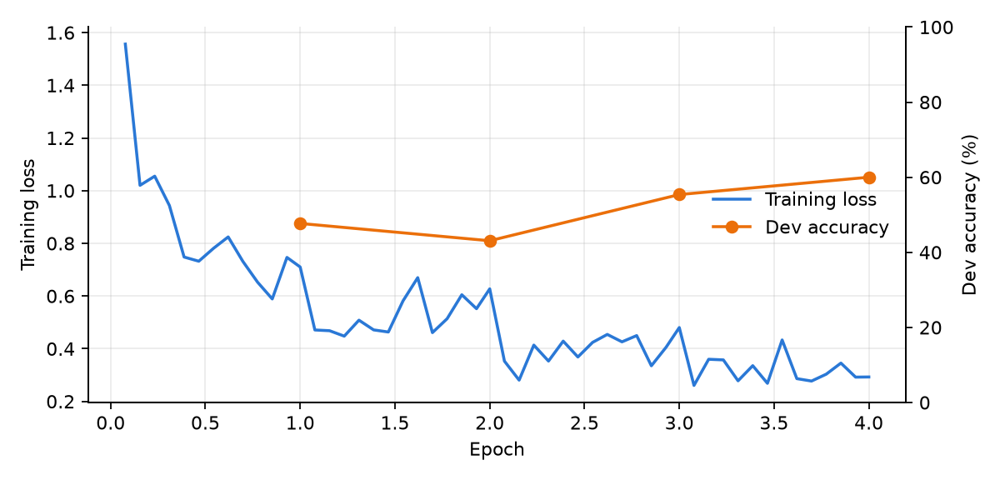

# Local answer model: training and testing report

AI Student Assistance Chatbot (P08). Generated 2026-11-24 from the saved training log and test results.

## 1. Summary

A 77-million-parameter language model (google/flan-t5-small) was fine-tuned on 1,027 question, passage and answer examples written from the project's 18 documents. It now writes the chatbot's answers on this computer's CPU, with no API key and no internet. It was then tested on 65 labelled student questions that were kept out of training.

| Test | Result |
|---|---|
| Model alone, held-out questions: correct | 58.5% of 65 |
| Same questions, same model before training | 15.4% |
| Whole chatbot with the local model | 58.5% |
| Whole chatbot quoting the documents (no model) | 56.9% |
| Questions on a document it never saw | 70.8% of 24 |
| Answers containing a figure that is not in the passages | 0.0% |
| Time per answer, whole chatbot (median) | 1.7 s |

The test set is small: one question is worth 1.5 percentage points, so differences of a few points between two rows are within the noise.

## 2. What was trained

| Item | Value |
|---|---|
| Starting model | google/flan-t5-small (pretrained, 77M parameters) |
| Task | Read the question and the retrieved passages; write a short answer and cite the passage as [n], or reply NO_ANSWER |
| Passages read per question | 3 |
| Training examples | 1,027 |
| Epochs / batch size / learning rate | 4 / 8 / 0.0005 |
| Input length (tokens) | mean 495, longest 662 |
| Hardware | CPU only, 12 threads |
| Training time | 75 minutes |

### 2.1 Training data

990 questions were written for training from the corpus documents, in the four wordings students use. Each question was run through the chatbot's real retriever, so the model was trained on the same kind of context it sees in use: the right passage mixed with related wrong ones.

| Kind of example | Count |
|---|---|
| Answer in the passages (retrieval order) | 344 |
| Question the documents do not cover, so the model must decline | 171 |
| Answer in the passages (passages shuffled) | 388 |
| Answering passage taken out, so the model must decline | 124 |

| Wording | Count |
|---|---|
| Direct | 468 |
| Hindi-English mix | 184 |
| Reworded | 183 |
| Casual | 192 |

Questions left out of the training set: 61 (answer passage not retrieved); 17 (too close to an evaluation question); 9 (duplicate).

### 2.2 Keeping the test honest

- The labelled questions in data/eval/questions.jsonl were never used for training. The split is the project's existing one: the DEV half chose the best epoch, the TEST half is reported here.
- The training questions were written without looking at the labelled questions, and any training question sharing 70% or more of its words with a labelled question was removed.
- The training and test questions are about the same documents. That is the intended use (a help desk for one university), but it means the test measures new questions on familiar documents. Section 4.4 tests an unfamiliar document.
- The training questions and answers were written by an AI assistant (Claude) from the documents, not collected from real students.

## 3. Training

| Epoch | Training loss | Dev accuracy | Dev answerable correct | Dev out-of-scope declined | Minutes |
|---|---|---|---|---|---|
| 1 | 0.853 | 47.7% | 49.0% | 43.8% | 24 |
| 2 | 0.526 | 43.1% | 46.9% | 31.2% | 17 |
| 3 | 0.398 | 55.4% | 53.1% | 62.5% | 17 |
| 4 (kept) | 0.315 | 60.0% | 59.2% | 62.5% | 17 |

The model from epoch 4 was kept because it scored highest on the dev questions (60.0%).



*Training loss (left axis) and accuracy on the dev questions after each epoch (right axis).*

## 4. Testing

How an answer is marked, the same rule the project's evaluation already uses: an answerable question is correct when the answer contains every labelled key fact (the date, amount or number a right answer must state); an out-of-scope question is correct when the assistant declines.

### 4.1 The model alone, before and after training

The model was given each test question with the top 3 retrieved passages, with no confidence gate in front of it. The untrained model was given the same text plus a written instruction.

| Measure | Before training | After training |
|---|---|---|
| Correct overall | 15.4% | 58.5% |
| Answerable questions answered correctly | 20.4% | 57.1% |
| Answerable questions answered wrongly | 79.6% | 32.6% |
| Answerable questions declined | 0.0% | 10.2% |
| Out-of-scope questions declined | 0.0% | 62.5% |
| Key facts present in the answers given | 18.8% | 67.2% |
| Answers that cite a passage | 67.3% | 100.0% |
| Answers that cite the passage holding the answer | 8.2% | 81.8% |
| Word overlap with the reference answer (F1) | 0.12 | 0.61 |
| ROUGE-L against the reference answer | 0.10 | 0.58 |

Retrieval sets the ceiling: the passage holding the answer was among the passages for 98.0% of the answerable test questions (top 4; the model reads the top 3).

| Wording of the question | Answered correctly |
|---|---|
| Casual | 43.8% |
| Direct | 92.3% |
| Hindi-English mix | 30.0% |
| Reworded | 60.0% |

| Document category | Answered correctly |
|---|---|
| Faqs | 44.4% |
| Notices | 63.6% |
| Policies | 50.0% |
| Regulations | 57.1% |
| Syllabus | 71.4% |

### 4.2 The whole chatbot

Question, retrieval, confidence gate, then the generator, exactly as the website runs it. When the local model writes a figure that is not in the passages, the chatbot discards the answer and quotes the documents instead.

| Measure | Local model | Quote the documents |
|---|---|---|
| Correct overall | 58.5% | 56.9% |
| Answerable questions answered correctly | 57.1% | 65.3% |
| Answerable questions answered wrongly | 32.6% | 12.2% |
| Answerable questions declined | 10.2% | 22.4% |
| Out-of-scope questions declined | 62.5% | 31.2% |
| Answers replaced by quotes after the figure check | 0.0% | not applicable |
| Median time per answer | 1.7 s | 0.2 s |
| 95th percentile time per answer | 2.7 s | 0.3 s |

With the local model the chatbot scored 1.5 points above the quote-only generator on these 65 questions.

### 4.3 Which confidence gate

The chatbot declines before generating when retrieval confidence is below a threshold. A model that can decline by itself can sit behind a looser gate. Both were measured; the dev column is the one to choose by.

| Gate | Threshold | Dev accuracy | Test accuracy | Test answerable correct | Test out-of-scope declined |
|---|---|---|---|---|---|
| Loose (better on dev) | 0.34 | 55.4% | 58.5% | 57.1% | 62.5% |
| Strict | 0.58 | 53.8% | 53.8% | 51.0% | 62.5% |

The website uses the loose gate for every language-model generator.

### 4.4 A document the model never saw

"Sports Complex and Gymkhana Rules" was written only for this test. It is not in the corpus and no training question came from it. It was indexed as if it had just been uploaded, and 24 questions were asked (18 answerable, 6 not). Retrieval found a passage of the new document for 100.0% of the answerable ones.

| Measure | Unseen document | Test questions on corpus documents |
|---|---|---|
| Correct overall | 70.8% | 58.5% |
| Answerable questions answered correctly | 77.8% | 57.1% |
| Out-of-scope questions declined | 50.0% | 62.5% |
| Answers containing a figure not in the passages | 0.0% | 0.0% |

### 4.5 Faithfulness: the figure check

A small model can write a fee or a date that looks right and is not. Every number in an answer is therefore looked up in the passages the model was given. Across the answers in 4.1 and 4.4:

|  | Count |
|---|---|
| Answers checked | 70 |
| Flagged: a figure was not in the passages | 0 |
| Flagged answers that were wrong (good catches) | 0 |
| Flagged answers that were right (false alarms) | 0 |
| Wrong answers the check did not catch | 28 |

The check only sees numbers. A wrong answer that copies a real figure from the wrong sentence passes it.

### 4.6 Speed

On this computer's CPU the model alone takes 1.5 s per answer. The whole chatbot answers in 1.7 s (median) with the local model and 0.2 s when quoting the documents.

## 5. Sample answers from the test

### 5.1 Marked correct

| Question | Model's answer |
|---|---|
| What is the application fee for B.Tech admission for 2026-27? | The application fee for 2026-27 is Rs. 1,500, paid online on admissions.svu.example. [1] |
| What are the L-T-P hours and credits of Data Structures CS201? | Data Structures (CS201) has the course code CS201 and is taught in Semester 3. It is a 3-0-2 course worth 4 credits. [2] |
| How do I convert my CGPA into a percentage? | To convert CGPA into an approximate percentage, multiply the CGPA by 9.5. [1] |
| What is the last date to pay the even semester fee without any late fee? | The last date for payment of the even semester fee without any late fee is 31 December 2026. [1] |
| forgot my portal password what do i do | Use the Forgot Password link, which sends an OTP to your registered mobile number. If the number has changed, email itsupport@svu.example from your SVU email with your roll number. [1] |

### 5.2 Marked wrong

| Question | Kind | Model's answer |
|---|---|---|
| my report shows 35% similarity, what will happen to me | answerable | A report with a similarity above 25% is rejected, and the student has to repeat the project phase in the next semester. [2] |
| hostl gate kab band hota hai | answerable | NO_ANSWER |
| if i withdraw 20 days after classes start how much fee comes back | answerable | A withdrawal application received 16 to 30 days after classes begin gets a 70% refund of the semester academic fee (tuition and development fee) as per the table below. [1] |
| do i need 60% in 12th for btech admission | answerable | No separate certificate is needed, but a self-declaration of activities during the gap must be submitted at the time of document verification. [1] |
| which books r prescribed for data structures | answerable | Fundamentals of Data Structures in C is taught to B.Tech CSE students in Semester 3 at Sutlej Valley University (SVU). [3] |
| How many credits must I have earned to be allowed into the fifth semester? | answerable | A student must have earned 26 out of 42 credits of Semesters 1 and 2 to enter Semester 5. [1] |
| What is the plagiarism limit for a final-year project report? | answerable | The final project report cannot be submitted to the examination office without a similarity certificate signed by the guide. [1] |
| can i pay fees in 2 parts? any processing charge | answerable | Yes. The fee can be paid online on the student portal by UPI, net banking, debit card or credit card. [2] |

## 6. Limits of this test

- 65 test questions and 24 unseen-document questions are few. Treat the percentages as rough.
- The corpus is sample data for a fictional university, and the questions were written for the project, not asked by real students.
- Marking by key facts is strict and literal: an answer that states the fact in other words ("three quarters" for 75%) is marked wrong, and an answer that contains the fact inside a wrong sentence is marked right.
- The model has no memory of the conversation. Follow-up questions work only because the chatbot searches them together with the previous question.
- The model was trained once, with one random seed. A second run would give somewhat different numbers.

## 7. How to repeat it

```
pip install -r requirements-model.txt
python -m training.data          # build data/train/train.jsonl
python -m training.train         # fine-tune; --resume continues a stopped run
python -m training.test_model    # writes data/eval/local_model_test.json
python -m training.report        # writes this report
```

Files: training questions in data/train/raw/, training log in models/svu-flan-t5/training_log.json, every test answer in data/eval/local_model_test.json.
